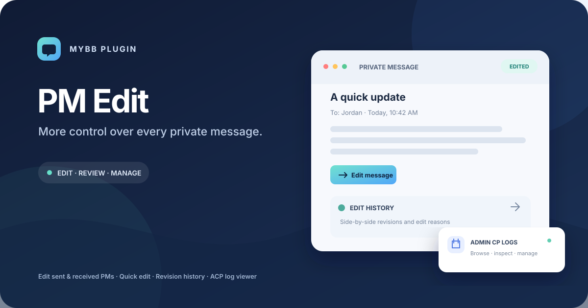

# PM Edit for MyBB

Adds an edit button to private messages. Users can edit the messages they sent and the messages they received, with an optional reason, a side-by-side edit history and an Admin CP log viewer.

<p align="center">
  
</p>

- **Version:** 1.2.1 in `_info()`, 1.1.0 in the file header
- **Codename:** `pm_edit`
- **Compatibility:** MyBB 1.8.x (`18*`)
- **Author:** PARAD0X — [MyBB profile](https://community.mybb.com/user-134311.html)
- **License:** GPL-3.0
- **Dependencies:** PluginLibrary 13, bundled as `inc/plugins/pluginlibrary.php`

## Features

- Edit button under every private message the current user sent or received.
- Full edit page with subject, message, BBCode editor and edit reason.
- Quick edit popup directly on the PM read page, saving over AJAX.
- Edit history stored per PM, with a word-level side-by-side diff of the old and new text.
- "Edited by X on Y" notice under the message.
- Optional hard edit: editing a sent PM also rewrites the recipient's copy.
- ACP page under **Tools → PM Edit Logs** to browse, inspect and delete history rows.
- Daily task that prunes history entries older than seven days.
- Settings for allowed usergroups, time limit, folders, hard-edit groups and history cap.

## Requirements

- MyBB 1.8.x.
- PHP 7.0 or newer.
- PluginLibrary 13.
- A MySQL/MariaDB database. The installer and schema use MySQL-only DDL (see defects).

## Installation

1. Copy the contents of this repository over the forum root.
2. Go to **Admin CP → Configuration → Plugins**, find **PM Edit** and click **Install**, then **Activate**.
3. Configure it under **Configuration → Settings → PM Edit Settings**.
4. The log viewer appears under **Tools → PM Edit Logs**.

Installation creates the history table and adds four columns to `privatemessages`. Activation registers the settings and templates through PluginLibrary, adds the stylesheet to the stylesheet cache, edits core templates and inserts the prune task. Deactivation only reverts three of those edits. Uninstall drops the table, the four columns, the settings, the templates, the task and the template group.

## Editing model

MyBB stores one row per private message copy. A sent PM is the sender's row (`folder = 2`), and each recipient has their own row in their inbox (`folder = 1`). The plugin treats each row independently:

- Editing a received PM changes **only the recipient's copy**. The sender and other recipients keep the original.
- Editing a sent PM changes **only the sender's copy** unless *Allow Hard Editing Sent PMs* is enabled and the user is in a hard-edit group.
- Hard edit finds the recipient row by `fromid` + `toid` + a ±60 second `dateline` window, stores a `pm_conversation_key` on both rows and then updates the recipient copy.

## Settings

Thirteen settings are registered in the `pm_edit` group.

| Setting | Default | Purpose |
| --- | --- | --- |
| Enable PM Editing | Yes | Master switch. |
| Edit Time Limit | 60 | Minutes after `dateline` during which editing is allowed; `0` = unlimited. |
| Allowed Usergroups | `2,3,4,6` | Groups that may edit; empty means every logged-in user. |
| Allow Editing Received PMs | Yes | Recipients may edit their copy. |
| Allow Editing Sent PMs | Yes | Senders may edit their copy. |
| Allow Hard Editing Sent PMs | No | Also rewrite the recipient's copy. |
| Hard Edit Allowed Usergroups | `3,4,6` | Groups allowed to hard edit. |
| Track Edit History | Yes | Store old and new text on each edit. |
| Show Edit Notice | Yes | Print the "edited by" line. |
| Allow Edit Reason | Yes | Show the reason field. |
| Max Edit History Entries | 10 | Per-PM history cap; `0` = unlimited. |
| Excluded Folders | `3,4` | Folder ids where editing is blocked (default drafts and trash). |
| Use Editor in Quick Edit | Yes | Load SCEditor for the quick edit box. |

Three settings share disporder `5` in `settings.json`, so their relative order in the ACP is not stable.

## Permissions

Front end:

- Guests are rejected.
- Users in a group with `cancp` or `issupermod` bypass the usergroup list, the folder list, the sent/received switches and the time limit.
- Everyone else must be in *Allowed Usergroups* and must be the sender or the recipient of the row.

Admin CP: the plugin adds **no** permission entry. MyBB's `check_admin_permissions()` only denies an action when the module declares a permission for it, so every administrator with access to the Tools module can open the log page and delete rows.

## Database

New table:

```
{TABLE_PREFIX}pm_edit_history
  hid               auto increment
  pmid              privatemessages.pmid
  uid               owner of the row at edit time
  edituid           user who performed the edit
  original_subject  subject before the edit
  original_message  message before the edit
  edited_subject    subject after the edit
  edited_message    message after the edit
  editreason        optional reason, max 150 characters
  dateline          timestamp
  ipaddress         editor IP as text
```

Indexes: primary `hid`, plus `pmid`, `edituid` and `dateline`. Engine is MyISAM.

Four columns are added to `privatemessages`:

| Column | Type | Purpose |
| --- | --- | --- |
| `edituid` | int unsigned | Last editor |
| `edittime` | int unsigned | Last edit timestamp |
| `editreason` | varchar(150) | Last reason |
| `pm_conversation_key` | varchar(32) | Links a sent row to the recipient row for hard edits |

## Hooks

| Hook | Function | Purpose |
| --- | --- | --- |
| `private_start` | `pm_edit_load_editor` | Loads SCEditor assets for quick edit. |
| `private_start` | `pm_edit_action_handler` | Dispatches `editpm`, `do_editpm` and `pm_edit_history`. |
| `postbit` | `pm_edit_postbit` | Adds the edit button and history link for PMs. |
| `postbit_pm` | `pm_edit_postbit` | Same, for the PM postbit path. |
| `postbit` | `pm_edit_postbit_signature` | Registered twice; dead code. |
| `xmlhttp` | `pm_edit_xmlhttp` | Quick edit GET/POST endpoint. |
| `global_start` | `pm_edit_language` | Hardcoded English defaults. |
| `private_read_end` | `pm_edit_private_read` | Builds the "edited by" notice. |
| `global_intermediate` | `pm_edit_headerinclude` | Dead CSS/JS injector. |
| `admin_tools_menu` | `pm_edit_admin_menu` | Adds the log page. |
| `admin_tools_action_handler` | `pm_edit_admin_action_handler` | Declares the action. |
| `admin_load` | `pm_edit_admin_load` | Renders the log page. |

## Requests

| Request | Handler |
| --- | --- |
| `private.php?action=editpm&pmid=N` | Full edit form |
| `private.php?action=do_editpm` (POST, `my_post_key`) | Save the edit |
| `private.php?action=pm_edit_history&pmid=N` | History page |
| `xmlhttp.php?action=quick_edit_pm&do=get_pm&pmid=N` | Raw message for the quick editor |
| `xmlhttp.php?action=quick_edit_pm&do=update_pm` (POST, `my_post_key`) | Quick edit save |
| `index.php?module=tools-pm_edit_logs` | ACP log list |
| `index.php?module=tools-pm_edit_logs&action=view&hid=N` | ACP log detail |

## Repository layout

```
inc/
├── languages/
│   └── english/
│       ├── admin/
│       │   └── pm_edit.lang.php
│       └── pm_edit.lang.php
├── plugins/
│   ├── pm_edit.php
│   ├── pluginlibrary.php
│   └── PM_Edit/
│       ├── Admin/module.php
│       ├── Assets/pm_edit.css
│       ├── Assets/pm_edit.js
│       ├── Functions/edit_functions.php
│       ├── Functions/permission_functions.php
│       ├── Templates/*.html          (8 templates)
│       ├── database.sql
│       ├── install.php
│       ├── settings.json
│       └── uninstall.php
└── tasks/
    └── pm_edit_prune_logs.php
```

Template keys are registered under the `pmedit` prefix (`pmedit_edit_button`, `pmedit_edit_form`, …), even though the files and the folder are named `pm_edit`.

## Known defects and limitations

These are properties of the current source, documented rather than fixed.

### Security and authorisation

1. **Any administrator can read and rewrite any private message.** `pm_edit_can_edit_pm()` returns `true` for any user whose group has `cancp` or `issupermod`, *before* the sender/recipient test. The `xmlhttp` handler loads a PM by `pmid` with no `uid`/`fromid` filter, so `xmlhttp.php?action=quick_edit_pm&do=get_pm&pmid=N` returns the full raw message for any PM on the board, and `do=update_pm` writes to it. That includes the hard-edit path, which can then overwrite a recipient's copy.
2. **Admin log page has no permission gate.** There is no `admin_tools_permissions` hook and no entry in the Tools permissions array. Any admin group with Tools access sees every stored original message, subject, editor and IP, and can delete rows.
3. **Log deletion has no CSRF protection.** `delete`, `bulk_delete` and `delete_all` are POST branches with no `verify_post_check()` call, and the forms contain no `my_post_key`. A crafted form can wipe the entire audit trail. The `do=delete&hid=N` link in the table is a GET request while the handler only acts on POST, so that link does nothing at all.
4. **Hard-edit matching can rewrite the wrong message.** When `pm_conversation_key` is empty the plugin updates every row with the same `fromid` and `toid` inside a ±60 second window around the sent row's `dateline`, then edits one of them. Two messages to the same person sent within a minute can be cross-linked, and the `LIMIT 1` fetch means only one recipient copy of a multi-recipient PM is ever updated.
5. **Recipients can silently rewrite history.** A recipient may edit their received copy and the history page shows the change as if it were an authoritative edit. Nothing marks received-copy edits as local to the recipient.
6. **Quick-edit read endpoint has no post key check.** `do=get_pm` accepts a plain GET and returns the JSON-encoded message body. It is gated by the same broken permission check as defect 1. The post key sent in the URL is never verified on this branch.
7. **Time limit is measured from `dateline`, not from the last edit.** Editing a message does not extend the window, and an old PM cannot be corrected even immediately after receiving a long-overdue reply. Conversely, an edited PM that was sent recently stays editable.
8. **`cancp` also bypasses the excluded-folder list.** Admins can edit drafts and trash, because the bypass happens before the folder check.

### Data integrity

9. **History is written before the update.** `pm_edit_save_history()` inserts the row, then `update_query()` runs with no result check. A failed update leaves a history entry for an edit that never happened, and the AJAX response still reports success.
10. **Deleted PMs leave history behind.** Nothing hooks PM or folder deletion, so `pm_edit_history` rows survive the message, and the daily prune only removes rows older than seven days.
11. **The prune task ignores the settings.** `inc/tasks/pm_edit_prune_logs.php` hardcodes seven days and does not read `pm_edit_max_edit_history`. It also compares `$db->delete_query()` (a result resource) with `> 0`, so the task log line is unreliable.
12. **Uninstall drops columns it may not own.** `edituid`, `edittime`, `editreason` and `pm_conversation_key` are dropped whenever they exist, without checking whether this plugin created them.
13. **Install and schema are MySQL-only.** `database.sql` uses `ENGINE=MyISAM`, the installer uses `INT UNSIGNED ... ADD COLUMN`, `ADD INDEX`, and `show_fields_from()`. PostgreSQL and SQLite installs fail.
14. **No schema version or upgrade path.** Columns are added only during `_install`, guarded by `pm_edit_is_installed()` which checks the history table alone. A half-installed board (table present, columns missing) is treated as installed and every edit fails.
15. **`pm_conversation_key` index is only created with the column.** If the column already exists without the index, the index is never added.
16. **Uninstall relies on a second, wrong table-name convention.** The fallback deletes template titles `pm_edit_*`, but PluginLibrary registers them as `pmedit_*`. Without PluginLibrary, uninstall leaves every registered template in the database, and the fallback install path registers `pm_edit_*` titles that the code never requests, so the edit form and history page render empty.
17. **`pm_edit_remove_templates()` is declared in both `install.php` and `uninstall.php`.** Loading both files in one request is a fatal redeclare.
18. **Subject length is unvalidated.** The form allows 120 characters and the save path has no upper bound, so an over-long subject is truncated by the column or rejected by strict SQL mode.
19. **Editing bypasses PM limits.** There is no `maxmessagelength` check, no flood check and no quota check on the edit paths; a stored PM can be expanded past the board's message limit.
20. **Quick edit cannot change the subject, full edit can.** The two paths store different history shapes (quick edit records the unchanged subject as `edited_subject`).
21. **History keeps full message copies.** There is no size cap, no compression and no shared storage, so a long PM edited often multiplies storage by the history cap.

### Functional

22. **Deactivation is incomplete.** It removes the postbit button/history variables and a `headerinclude` CSS link that was never added. It leaves the `private_read` `{$pm['edit_notice']}` edit, the cached stylesheet, the prune task and every history row in place.
23. **The CSS/JS injector never runs.** `pm_edit_headerinclude()` is hooked to `global_intermediate` and edits a `$template` variable that does not exist at that point in `global.php`. Its `str_replace()` also writes the literal text `{$mybb->asset_url}` rather than a URL. CSS therefore only arrives through the PluginLibrary stylesheet cache, and `pm_edit.js` only arrives through the SCEditor loader.
24. **`pm_edit.js` is almost entirely unused.** The file only defines `pmEditExpandDiff()` and `pmEditCollapseDiff()`, and no template calls them. The diff preview has no expand/collapse control.
25. **`pm_edit_postbit_signature()` is dead code, and hooked twice.** It is registered on `postbit`, a hook that is not fired for PMs (`build_postbit()` fires `postbit_pm` for `post_type = 2`), and the same registration appears twice in the main file. `pm_edit_get_notice()` therefore never runs.
26. **`pm_edit_can_view_history()` is never called.** History access is gated by `pm_edit_can_edit_pm()` instead, so a user who may not edit a row (for example a recipient with received editing disabled) cannot read the history of edits the sender made through hard edit.
27. **Both page controllers call `output_page()` without `exit`.** `pm_edit_show_edit_form()` and `pm_edit_show_history()` return into `private.php`, which then finishes its own request. It currently produces no second page, but it is fragile and keeps all the remaining work in the request.
28. **SCEditor assets load on every `private.php` request.** `pm_edit_load_editor()` runs on the inbox, tracking, folder and export pages as well, re-emitting the `codebuttons` CSS/JS by regex extraction. That duplicates assets already loaded by the compose page and ignores any non-link markup in the template.
29. **The stylesheet hotlinks an icon from a third party.** `.pm_edit_history_link span` loads `https://8upload.com/image/.../history.png`. Availability, tracking and mixed-content rules are outside the forum's control.
30. **The ACP log page is a fixed 100 rows.** No pagination, no search, no filter and no sort control. The query orders by `dateline` and truncates.
31. **The ACP action handler declares an empty file.** `file => ''` means `admin/index.php` would `require` the tools module directory if the `admin_load` guard ever misses, for example when the page is reached as `module=tools&action=pm_edit_logs`.
32. **Routing keys on the raw module string.** `pm_edit_admin_load()` compares `$mybb->input['module']` with `tools-pm_edit_logs`, so alternate routes are silently ignored instead of redirected.
33. **Admin labels are hardcoded.** `PM Edit Logs`, `Delete Selected`, `Selected logs deleted successfully.`, the alerts and the confirm prompts are English literals even though matching `pm_edit_log_*` strings exist in the admin language file.
34. **`build_profile_link()` output is passed through `htmlspecialchars_uni()` in the log editor column.** The username is escaped and then wrapped in a link, so double escaping or broken markup depends on the input.
35. **The "Back to Logs" control is a submit button with an `onclick` redirect.** It submits the form as well as navigating, and the form has no action field of its own.
36. **The edit history diff is quadratic.** `pm_edit_compute_diff_with_positions()` builds a full `old_words × new_words` LCS matrix, and `pm_edit_diff_highlight()` runs `similar_text()` first, which is worse than quadratic on long strings. A long PM with a long history can exhaust memory or time in a single history page view.
37. **Diff output drops unchanged text by design.** Only changed regions with three words of context are printed, and since the expand helpers are not wired up, the reader cannot see the rest of the message from the history page.
38. **The history page has no pagination either.** Every stored revision for a PM is loaded and rendered in one page.
39. **Per-post overhead.** `pm_edit_has_history()` runs a `COUNT(*)` for every PM post, and each history link fetches `pmedit_edit_history_link` through `$templates->get()` because no `pmedit_*` key is added to `$templatelist`. Both add queries per message.
40. **`pm_edit_show_history()` requires the editing permission even for viewing.** See defect 26.

### Code quality and integration

41. **Template edits are not idempotent.** Activation replaces `{$post['button_delete_pm']}` with a concatenation of three variables. Running activation again (or activating without a clean deactivate) finds that same prefix and appends the variables a second time, producing duplicate edit buttons and history links.
42. **The `private_read` notice edit is duplicated the same way.** `{$message}` is replaced with `{$message}{$pm['edit_notice']}`; a second activation appends the notice twice.
43. **Hardcoded English in JavaScript.** The quick-edit code embedded in `pm_edit_button.html` uses `Save Changes`, `Cancel Edit`, `Saving...`, `Message updated successfully`, `Could not find message container` and `Error saving message:` directly, plus `console.log` calls, instead of language strings.
44. **The quick-edit UI is 9.7 KB of inline JavaScript inside a template.** It builds the form, wires SCEditor, posts the AJAX request and updates the DOM from a registered template, which should be an asset.
45. **`pm_edit_language()` invents English strings on `global_start`.** It assigns `pm_edit_button`, `pm_edit_title`, `pm_edit_reason`, and similar properties from hardcoded English, bypassing `inc/languages/english/pm_edit.lang.php`; the language file is loaded later and cannot override them.
46. **Language file and code disagree on names.** `pm_edit_no_permission` and `pm_edit_updated` exist but the code uses `$lang->no_permission` and hardcoded success text; `pm_edit_original_subject`/`edited_subject` are never used because the history template only prints the diff.
47. **A duplicate key exists in the editor language array.** `quote` is assigned twice in `quick_editor_build_language()`.
48. **The global helper name is generic.** `quick_editor_build_language()` lives in this plugin's main file and is not prefixed, so another "quick editor" plugin can collide with a fatal redeclare.
49. **`quick_editor_build_language()` interpolates `json_encode()` output directly into a `<script>` block** without escaping `</script>`. Current strings are fixed, so it is safe today, but the helper is unsafe for arbitrary text.
50. **The fallback template path uses a different prefix and a stale version number.** It inserts `pm_edit_*` titles with `version => '1827'` (MyBB 1.8.27) while PluginLibrary uses `pmedit_*`; the two paths cannot coexist.
51. **Plugin metadata is inconsistent.** `_info()` reports 1.2.1, the header docblock reports 1.1.0, and the header author is `PARADOX` while `_info()` uses `PARAD0X`.
52. **Uninstall does not clean admin permission keys.** Any stored `tools` permission arrays that mention `pm_edit_logs` are left behind, because no permission key is ever registered or removed.
53. **No uninstall hook for the `pm_conversation_key` index.** Dropping the column removes the index implicitly on MySQL, but the code never verifies it and PostgreSQL behaves differently.
54. **`pm_edit_install_run()` splits `database.sql` on every semicolon.** The current file is safe, but any future default value or comment containing `;` breaks the installer.

## Compatibility notes

- Tested against MyBB 1.8.41 default templates. The `postbit`, `postbit_classic` and `private_read` edits assume the stock markup.
- `postbit` and `postbit_classic` both receive `{$post['button_edit_pm']}` and `{$post['pm_edit_history']}`; `pm_edit.activate` inserts them after `{$post['button_delete_pm']}`.
- The `xmlhttp` endpoint requires the user to be logged in, which MyBB enforces before the hook runs.
- PluginLibrary 13 is bundled unmodified. Its header declares LGPL-3.0; the GPL-3.0 license in this repository covers the PM Edit code only.

## License

GPL-3.0. See [LICENSE](LICENSE).
